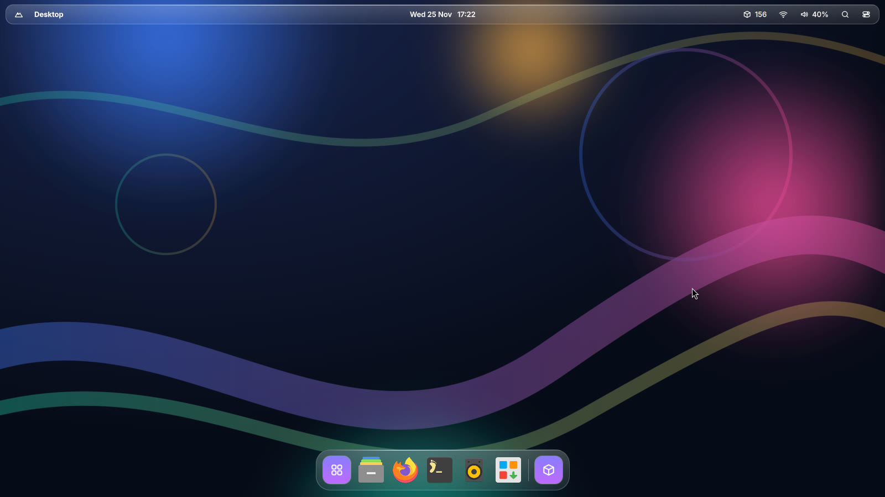
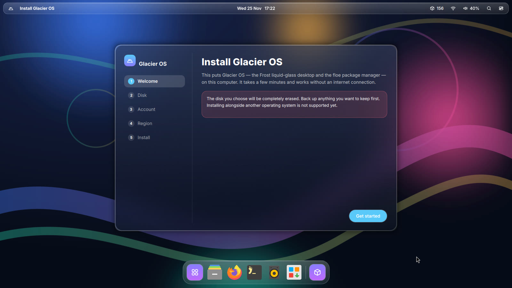
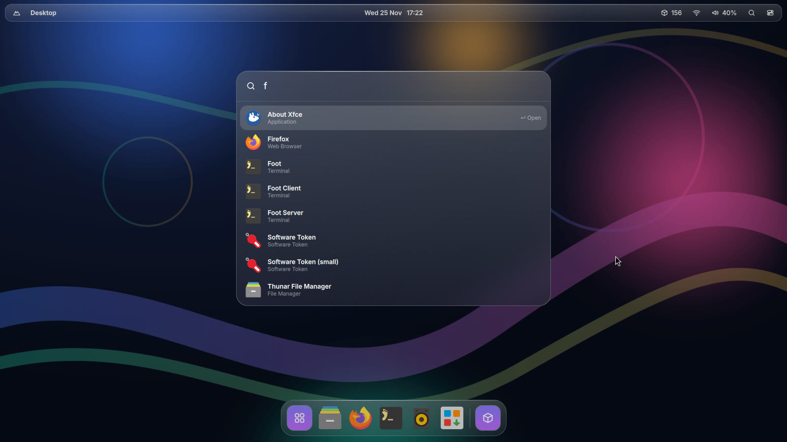
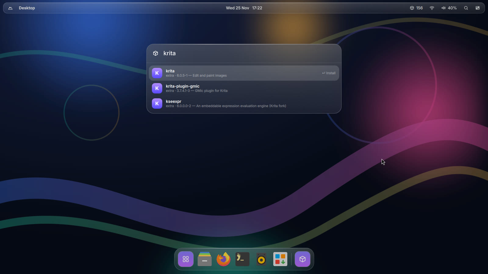
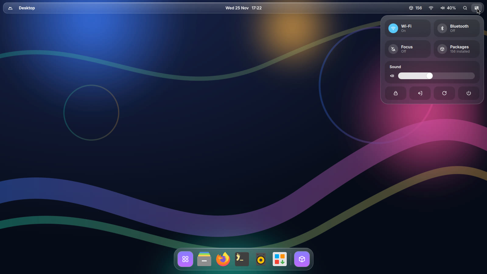
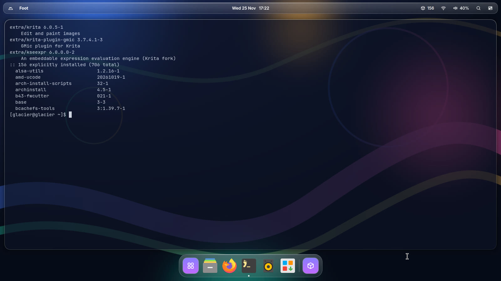
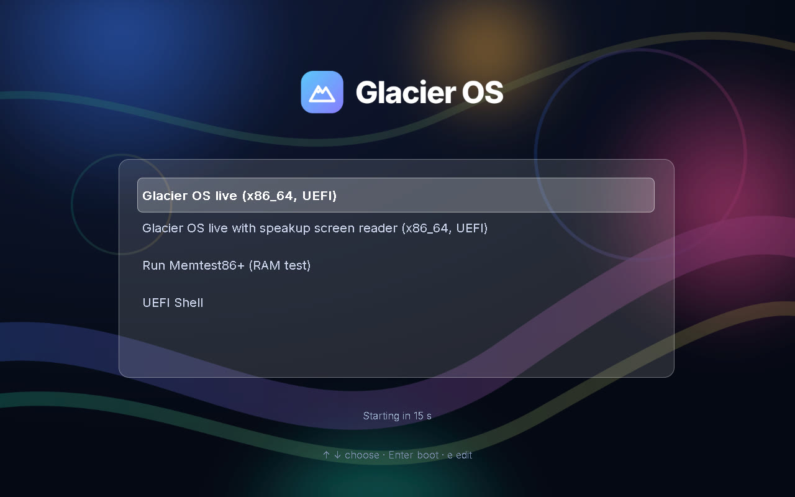

<p align="center">
  
</p>

<p align="center">
  <a href="https://github.com/lompendans/glacier-os/releases/latest"><b>Download the ISO</b></a> ·
  <a href="#screenshots">Screenshots</a> ·
  <a href="#building-windows--docker-desktop">Build it yourself</a>
</p>

## This project was made with AI.

#  Glacier OS

An Arch-based Linux distribution with a liquid-glass desktop (**Frost**) and its own
package manager (**floe**). Version 0.1 "Floe" — early development.



## Screenshots

All screenshots are taken from the real live ISO running in a virtual machine.

| | |
|---|---|
|  |  |
| **Installer** — opens on the live desktop; offline, BIOS + UEFI | **Launcher** — `Super+Space`, apps and packages in one search |
|  |  |
| **Package search** — `Super+P`, powered by floe | **Control Center** — Wi-Fi, Bluetooth, Focus, volume, power |
|  |  |
| **floe** — pacman with generations and rollback | **Boot menu** — themed GRUB on the live USB and installed systems |

## What's inside

| Part | What it is | Where |
|---|---|---|
| **floe** | Package manager: pacman + numbered generations + rollback | [`floe/`](floe) |
| **Frost** | Desktop: Hyprland 0.57 (Lua config, glass blur) + a Quickshell top bar, dock, launcher and Control Center | [`frost/`](frost) |
| **Installer** | Glass-styled installer app + `glacier-install` backend: offline, whole disk, boots on BIOS and UEFI | [`installer/`](installer) |
| **Bootloader** | Glacier GRUB theme (live UEFI menu and installed systems) and a Glacier splash for the BIOS live menu | [`frost/grub/`](frost/grub) |
| **ISO** | Live image built with archiso from the official `releng` profile plus Glacier's overlay | [`iso/`](iso) |
| Live Demo trailer | Built from footage recorded on the real OS in QEMU | [`demo-trailer/`](demo-trailer) |
| Concept | Interactive HTML mockup of the UI the shell is built from | [`concept-ui/`](concept-ui) |

## Status — what works and what doesn't yet

- **Live ISO** ([download](https://github.com/lompendans/glacier-os/releases/latest)). Boots to the Frost desktop as user `glacier` (password `glacier`, passwordless sudo in the live session). Verified in QEMU: autologin → Hyprland → Frost bar/dock/launcher, glass blur on windows, Super-key shortcuts, floe reading the live system.
- Package lists are downloaded automatically once the network is up (`glacier-refresh-db.service`); until then `floe search` says to run `floe refresh`.
- The live session has 2 GiB of RAM-backed write space for trying out installs; give the VM at least 4 GiB of RAM.
- **VirtualBox:** set Display → Graphics Controller to **VMSVGA** and enable **3D Acceleration**.
- **Installer.** Opens automatically in the live session (also in the dock). Verified end to end in QEMU: UEFI install onto an empty 24 GB disk → reboot → themed GRUB → login → Frost desktop, with the chosen user, hostname and time zone, sudo requiring a password and no failed units. The same disk also boots in BIOS mode.
- The installer **erases the whole disk**. Dual-boot / choosing partitions is not supported yet. Layout: 1 MiB BIOS boot · 1 GiB EFI (FAT32, `/boot`) · ext4 root.
- Installed systems log in on the text console (or automatically, if chosen in the installer) and then start Frost; there is no graphical login screen yet.
- **floe** is tested (unit tests + an end-to-end suite against a fake pacman) but has not yet been used against real pacman on a long-lived system.
- **Frost** QML is also checked headless (sway, software renderer) by `frost/test/headless.sh`; there is no blur in that test — blur needs Hyprland.
- Blur uses Hyprland's `frost` blur variant with `glass.*` refraction settings; which variant reads the `glass.*` values is not documented yet, so expect tuning.

## floe

floe drives pacman for the real work (dependencies, signatures, mirrors) and adds
**generations**: after every change it records the exact installed package set in
`/var/lib/floe/generations/<n>.json`.

```text
floe search <query>      search the repositories (ranked; --json for scripts)
floe install <pkg>...    install packages (with a full upgrade, as Arch requires) (alias: add)
floe remove <pkg>...     remove packages + unused dependencies (alias: rm)
floe upgrade             full system upgrade         (alias: update — Arch has no partial upgrades)
floe list                explicitly installed packages
floe info <pkg>          package details
floe refresh             download fresh package lists (for search)
floe history             list generations
floe rollback [n]        return to generation n (default: the previous one)
```

- **Rollback** computes exactly what to install, downgrade or remove and restores
  install reasons (explicit vs dependency). It reinstalls exact versions from pacman's
  cache (`/var/cache/pacman/pkg`); if a needed file was cleaned it refuses **before**
  changing anything. Don't run `paccache -r` if you want old versions back.
- `install` runs `pacman -Syu --needed <pkgs>`: Arch does not support partial upgrades,
  and that is also what makes `floe refresh` (`pacman -Sy`) safe for search.
- Changes made with `pacman` directly are noticed and recorded as their own generation.
- Mutating commands re-run themselves through `sudo`. With snapper configured for `/`,
  floe also takes a btrfs snapshot before each change.
- Rollback is transactional at the pacman level, not an atomic filesystem switch: if
  pacman fails half-way, floe records the partial state and tells you how to go back.

## Frost

- `frost/hypr/hyprland.lua` — compositor settings, glass blur, layer rules, key bindings
- `frost/quickshell/` — the shell (`qs -p /usr/share/frost/quickshell`)
- Keys: `Super+Space` launcher · `Super+P` packages · `Super+A` Control Center ·
  `Super+Return` terminal · `Super+E` files · `Super+B` browser · `Super+Q` close
- Scripting: `qs -p /usr/share/frost/quickshell ipc call frost launcher|packages|controlCenter|search <text>`

## Installer

`glacier-install` copies the live system image (`/run/archiso/airootfs`) — no network needed — then removes the
live-only parts (autologin, passwordless sudo, archiso services and hooks, the installer itself), creates the
user, sets locale/time zone/hostname, rebuilds the initramfs (default + fallback) and installs GRUB for BIOS and,
when booted via UEFI, for UEFI (named entry + fallback path). It validates every input before touching the disk
and prints `PROGRESS <percent> <message>` lines that the GUI shows.

```bash
sudo glacier-install --list-disks
echo 'password' | sudo glacier-install --disk /dev/sdX --user ada --fullname 'Ada Lovelace' \n    --hostname glacier --timezone Europe/Istanbul --yes-wipe-disk
```

## Building (Windows + Docker Desktop)

```powershell
.\build-iso.ps1     # builds the glacier-dev image, then the ISO into out\
.\run-qemu.ps1      # boots the newest ISO in QEMU
```

On Linux: `docker build -t glacier-dev dev && docker run --rm --privileged -v "$PWD:/src" -v glacier-pkgcache:/var/cache/pacman/pkg glacier-dev bash /src/iso/build.sh`.

## Testing

```bash
# inside the glacier-dev container, with the repo at /src
cd /src/floe && cargo test && cargo build --release && bash tests/e2e.sh target/release/floe
bash /src/frost/test/headless.sh      # renders the shell headless → out/shots/*.png
```

## Roadmap

1. Installer: choose partitions / dual-boot, encryption, btrfs + snapper (floe already snapshots when snapper is set up)
2. A Frost-styled graphical login screen
3. A graphical Floe Store (the launcher's package search is the first step)
4. Settings app: accent colour, glass strength, wallpapers
5. Glacier package repository (signed) for Frost and floe themselves

[](https://gitdiagram.com/lompendans/glacier-os?utm_source=readme&utm_medium=picture)
